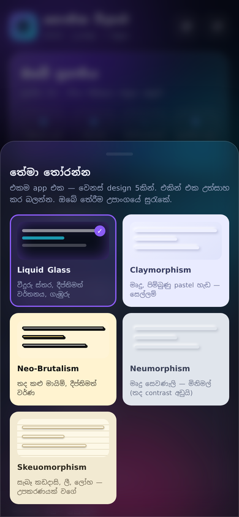
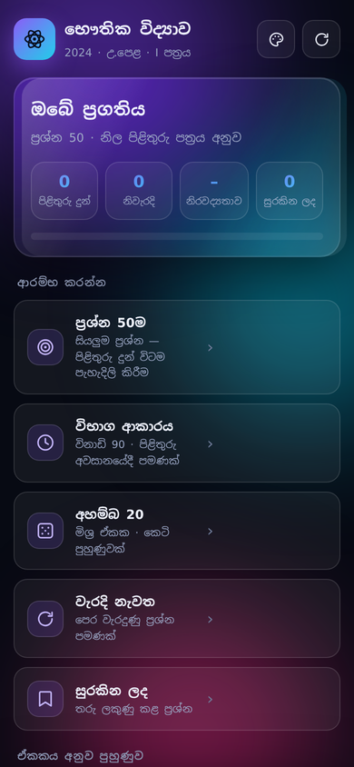
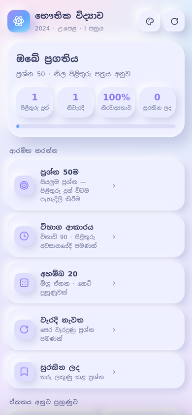
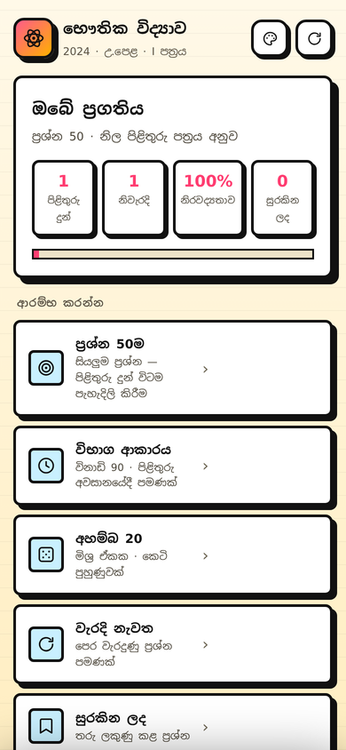
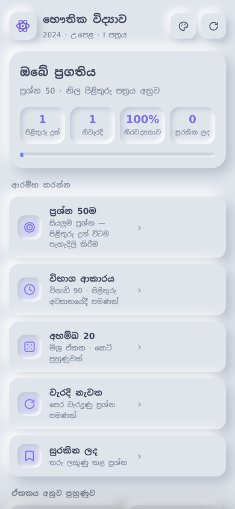
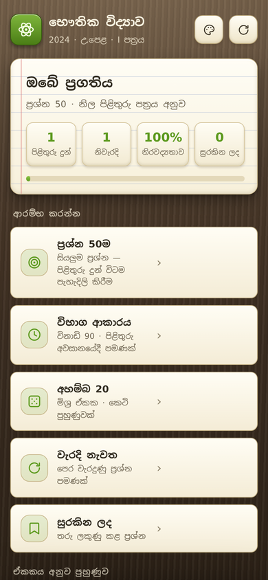
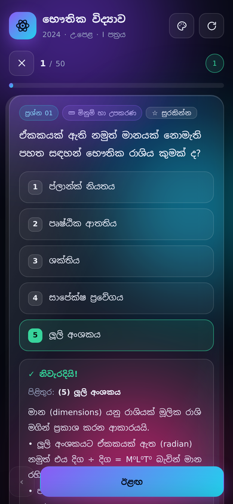
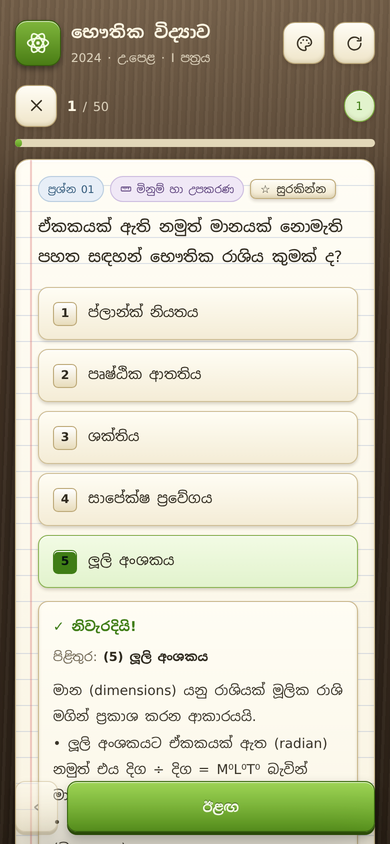
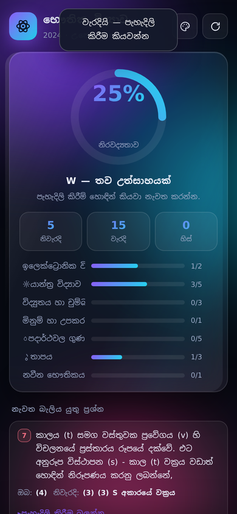

# 📘 2024 A/L භෞතික විද්‍යාව — MCQ පුහුණු යෙදුම

> ශ්‍රී ලංකා අ.පො.ස. (උසස් පෙළ) 2024 භෞතික විද්‍යාව **I පත්‍රයේ** බහුවරණ ප්‍රශ්න 50ම, නිල පිළිතුරු පත්‍රය අනුව, සිංහල මාධ්‍යයෙන් — සහ සෑම ප්‍රශ්නයකටම **පියවරෙන් පියවර පැහැදිලි කිරීමක්**.
>
> **එකම ගොනුවක්. Offline. දුරකථනයේ වැඩ කරයි. Build එකක් අවශ්‍ය නැහැ.**

<p align="center">
  
</p>

---

## ✨ විශේෂාංග

| | |
|---|---|
| 🎯 **ප්‍රශ්න 50** | 2024 පත්‍රයේ I පත්‍රය සම්පූර්ණයෙන් — විකල්ප 5ම සහිතව |
| ✅ **නිල පිළිතුරු** | විභාග දෙපාර්තමේන්තුවේ ලකුණු දීමේ පටිපාටියේ (Marking Scheme) පිළිතුරු වගුවට 100% ගැලපේ |
| 🧠 **පැහැදිලි කිරීම් 50** | හැම ප්‍රශ්නයකටම ගණනය පියවරෙන් පියවර + `මතක තබා ගන්න` සූත්‍ර කොටුව |
| 🗂️ **ඒකක 8** | මිනුම් · යාන්ත්‍ර · පදාර්ථ · තාපය · තරංග · විද්‍යුතය · ඉලෙක්ට්‍රොනික · නවීන |
| 🎮 **Mode 5** | ප්‍රශ්න 50ම · විභාග ආකාරය (විනාඩි 90) · අහම්බ 20 · වැරදි නැවත · සුරකින ලද |
| 📊 **ලකුණු කිරීම** | නිරවද්‍යතාව · ඒකක අනුව breakdown · grade (A/B/C/S/W) · වැරදි ප්‍රශ්න review |
| 🎨 **තේමා 5** | Liquid Glass · Claymorphism · Neo-Brutalism · Neumorphism · Skeuomorphism |
| 🔊 **ශ්‍රව්‍ය** | ප්‍රශ්නය හෝ පැහැදිලි කිරීම උපාංගයේ Sinhala voice එකෙන් කියවාගන්න |
| 📱 **Offline** | සිංහල font එකම base64 embed කරලා — network නැතුවත් වැඩ කරයි |
| 💾 **සුරැකීම** | ප්‍රගතිය, ලකුණු, bookmark, තේමාව — සියල්ල `localStorage` එකේ |

---

## 🎨 තේමා 5

<p align="center">
  
  
  
  
  
</p>

| තේමා | විස්තරය |
|---|---|
| **Liquid Glass** *(default)* | ගැඹුරු රාත්‍රී පසුබිම, වීදුරු ස්තර, ධාවනය වන වර්තන දීප්තිය |
| **Claymorphism** | මෘදු පිම්බුණු pastel හැඩ, දෙගුණ සෙවණැලි — gamified study feel |
| **Neo-Brutalism** | තද කළු මායිම්, hard offset shadows — වඩාත් පැහැදිලි contrast |
| **Neumorphism** | `#e0e5ec` මත extruded / embossed — මිනිමල් |
| **Skeuomorphism** | කඩදාසි කාඩ් (ruled lines), ලී desk, ලෝහ buttons |

<p align="center">
  
  
  
</p>

---

## 🚀 භාවිතය

### 1 · කෙලින්ම
`index.html` එක බාගෙන double-click කරන්න. ඒ විතරයි.

### 2 · දුරකථනයේ (offline)
`index.html` එක දුරකථනයට copy කර, Chrome/Safari වලින් විවෘත කරන්න →
**"Add to Home screen"** → යෙදුමක් වගේ වැඩ කරයි (network අවශ්‍ය නැහැ).

### 3 · GitHub Pages එකෙන්
```bash
# Settings → Pages → Source: Deploy from a branch → main / (root)
```
ඉන්පසු `https://<username>.github.io/<repo>/` ලෙස browse කරන්න.

### ⌨️ Keyboard (desktop)
| Key | ක්‍රියාව |
|---|---|
| `1`–`5` | විකල්පය තෝරන්න |
| `→` / `Enter` | ඊළඟ |
| `←` | පෙර |
| `Esc` | තේමා තෝරනය වසන්න |

---

## 📁 ගොනු ව්‍යුහය

```
.
├── index.html                           ← ⭐ යෙදුම (single file, offline)
├── 2024-paper-questions-and-answers.md   ← මුද්‍රණය කරගත හැකි ඔත්තු පිටපත
├── assets/                              ← README screenshots
└── source/                              ← වෙනස්කම් කරන්න ඕන නම්
    ├── app_shell.html                    ← UI + logic (template)
    ├── theme.css                         ← තේමා tokens 5
    ├── q1.js / q2.js / q3.js             ← ප්‍රශ්න දත්ත (ප්‍රශ්න 1-50)
    ├── build.py                          ← build script
    ├── check.js                          ← දත්ත validators
    └── NotoSansSinhala.woff2             ← font (SIL OFL)
```

### Build එකක් කරන්නේ කොහොමද
```bash
cd source
python3 build.py          # → ../index.html
node check.js             # ප්‍රශ්න 50, විකල්ප 5, නිල key — verify
```

---

## 📖 ප්‍රශ්න දත්ත එකතු කරන්නේ කොහොමද

`source/q1.js` එකේ ආකෘතිය:

```js
{n:1, t:"m",
 q:"ප්‍රශ්නය...",
 o:["විකල්පය 1","විකල්පය 2","විකල්පය 3","විකල්පය 4","විකල්පය 5"],
 a:5,                         // නිවැරදි පිළිතුර (1-5)
 e:"පියවරෙන් පියවර පැහැදිලි කිරීම...",
 k:"මතක තබා ගන්න: සූත්‍රය / ඉඟිය"}
```

`t` (ඒකකය): `m` මිනුම් · `y` යාන්ත්‍ර · `p` පදාර්ථ · `t` තාපය · `th` තරංග · `v` විද්‍යුතය · `e` ඉලෙක්ට්‍රොනික · `n` නවීන

---

## 🔍 ගුණාත්මකභාවය

- ප්‍රශ්න 50/50 · විකල්ප 5/5 · duplicate 0 · JS errors 0
- **පිළිතුරු 50ම නිල marking scheme එකට ගැලපේ** (`check.js` එකෙන් automated)
- පැහැදිලි කිරීම් 50/50, ඒවායේ කියන පිළිතුර key එකට සමානයි
- Themes 5 × viewport 3 (320 / 390 / 768) — horizontal overflow 0
- Offline · sandboxed iframe · theme persistence — සියල්ල test කර ඇත

---

## 📚 මූලාශ්‍ර සහ ගෞරවය

- **ප්‍රශ්න හා නිල පිළිතුරු:** [ශ්‍රී ලංකා විභාග දෙපාර්තමේන්තුව](https://www.doenets.lk/) — 2024 අ.පො.ස. (උ.පෙළ) භෞතික විද්‍යාව I පත්‍රය
- **පැහැදිලි කිරීම්:** මෙම ව්‍යාපෘතිය සඳහා ලියන ලද්දක් (ඉගෙනුම් උපකාරකයක් ලෙස)
- **Font:** [Noto Sans Sinhala](https://fonts.google.com/noto/specimen/Noto+Sans+Sinhala) — SIL Open Font License 1.1

> ⚠️ **වියාචනය:** මෙය නිල යෙදුමක් නොවේ. ඉගෙනුම් උපකාරකයක් ලෙස පමණක් සාදන ලද්දක්. ප්‍රශ්න පත්‍රයේ අයිතිය ශ්‍රී ලංකා විභාග දෙපාර්තමේන්තුවට හිමිය.

---

## 📄 බලපත්‍රය

කේතය: [MIT](LICENSE) · ප්‍රශ්න පත්‍රය: විභාග දෙපාර්තමේන්තුව · Font: SIL OFL 1.1
